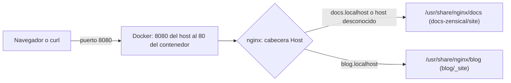

# Práctica NGINX: documentación con Zensical y blog con Jekyll

Despliego dos sitios estáticos con un único NGINX en un contenedor Docker:

- **Fase 1**: la documentación de [monium/gitanddocs](https://github.com/monium/gitanddocs), generada con Zensical, en `http://docs.localhost:8080`.
- **Fase 2**: un blog de reseñas de perfumes, generado con Jekyll, en `http://blog.localhost:8080`.

**Repositorio remoto:** https://github.com/franciscorodalf/practica-nginx

**RA/CE evaluados:** RA6 (a, b, c, d, h) · RA1 (b, c, f, g, h, i)

## Índice

1. [Arquitectura](#arquitectura)
2. [Cómo reproducirlo](#cómo-reproducirlo)
3. [Paso 0. Entorno](#paso-0-entorno)
4. [Paso 1. Repositorio y remoto](#paso-1-repositorio-y-remoto)
5. [Fase 1. Documentación con Zensical](#fase-1-documentación-con-zensical)
6. [Fase 2. Blog con Jekyll](#fase-2-blog-con-jekyll)
7. [Problemas encontrados](#problemas-encontrados)
8. [Avisos conocidos](#avisos-conocidos)

## Arquitectura

NGINX escucha en el puerto 80 del contenedor, que Docker publica en el 8080 del Mac. Cada sitio tiene su propio bloque `server`, y NGINX elige uno u otro según la cabecera `Host` de la petición.



```text
practica-nginx/
├── compose.yaml
├── nginx/conf.d/
│   ├── docs.conf
│   └── blog.conf
├── docs-zensical/      copia de gitanddocs (site/ se genera y no se versiona)
└── blog/               blog Jekyll (_site/ se genera y no se versiona)
```

## Cómo reproducirlo

```bash
cd docs-zensical && uv run zensical build --clean && cd ..
docker run --rm -v "$PWD/blog":/srv -v jekyll-gems:/usr/local/bundle -w /srv ruby:3.3 \
  sh -c "bundle install && bundle exec jekyll build"
docker compose up -d
```

Después: `http://docs.localhost:8080` y `http://blog.localhost:8080`.

---

## Paso 0. Entorno

Compruebo que tengo Docker (para NGINX y Jekyll), Git y `uv` (para Zensical):

```bash
docker --version && docker compose version && git --version && uv --version
docker run --rm hello-world
```

```text
Docker version 29.7.2, build a7dcaa6
Docker Compose version v5.4.0
git version 2.54.0 (Apple Git-157)
uv 0.11.26 (396ef7ce4 2026-06-30 aarch64-apple-darwin)

Hello from Docker!
This message shows that your installation appears to be working correctly.
```

La primera vez `hello-world` falló porque Docker Desktop estaba cerrado ([problema 1](#1-docker-desktop-cerrado)).

## Paso 1. Repositorio y remoto

Creo el repositorio y configuro la identidad **en local** (sin `--global`), con el nombre y el correo del aula virtual:

```bash
git init -b main
git config user.name "Francisco Yariel Rodriguez Alfonso"
git config user.email "francuban1278@icloud.com"
```

```text
Initialized empty Git repository in /Users/fran/Desktop/practica-nginx/.git/
```

Añado un `.gitignore` para no versionar lo que se regenera al compilar:

```text
.DS_Store
docs-zensical/site/
docs-zensical/.venv/
blog/_site/
blog/.jekyll-cache/
blog/.sass-cache/
```

Conecto el repositorio con GitHub por HTTPS (por SSH falló: [problema 2](#2-github-rechaza-la-conexión-ssh)) y subo `main`:

```bash
git remote add origin https://github.com/franciscorodalf/practica-nginx.git
git push -u origin main
```

```text
To https://github.com/franciscorodalf/practica-nginx.git
 * [new branch]      main -> main
branch 'main' set up to track 'origin/main'.
```

Cada fase se desarrolla en su propia rama (`fase-1`, `fase-2`) y se fusiona en `main` con `git merge --no-ff`, para que el merge quede visible en el historial.

---

## Fase 1. Documentación con Zensical

### 1.1 Copiar el proyecto y ajustar `site_url`

Copio gitanddocs en `docs-zensical/` **sin su carpeta `.git`** (la primera vez la dejé y Git lo trató como repositorio anidado: [problema 3](#3-repositorio-anidado-en-docs-zensical)).

```bash
git switch -c fase-1
git clone --depth 1 https://github.com/monium/gitanddocs.git docs-zensical
rm -rf docs-zensical/.git
```

En `docs-zensical/zensical.toml` cambio la URL pública, que Zensical usa para las URL canónicas y el sitemap:

```diff
-site_url = "https://www.example.com/"
+site_url = "http://docs.localhost:8080/"
```

### 1.2 Generar el sitio

```bash
cd docs-zensical
uv run zensical build --clean
ls site
```

```text
Creating virtual environment at: .venv
Installed 11 packages in 311ms
Build started
4 issues found
Build finished in 0.46s
```

```text
404.html  assets  get-site  index.html  markdown  search.json  sitemap.xml  tema-visual  trabajando-con-git
```

`uv run` crea el entorno `.venv` e instala Zensical según `pyproject.toml`. Los 4 avisos son anclajes rotos del material original ([avisos conocidos](#avisos-conocidos)).

### 1.3 Configurar NGINX

`nginx/conf.d/docs.conf`:

```nginx
server {
    listen 80 default_server;
    server_name docs.localhost localhost;

    root  /usr/share/nginx/docs;
    index index.html;

    location / {
        try_files $uri $uri/ =404;
    }

    error_page 404 /404.html;
}
```

- `default_server`: atiende cualquier petición cuyo `Host` no coincida con ningún `server_name`.
- `root`: la URI se añade a esta ruta (`/markdown/` → `/usr/share/nginx/docs/markdown/`).
- `try_files`: busca el archivo, luego el directorio con su `index.html` y, si no existe, devuelve 404.
- `error_page`: usa la página 404 de Zensical en lugar de la de NGINX.

`compose.yaml`:

```yaml
services:
  web:
    image: nginx:stable-alpine
    container_name: practica-nginx
    ports:
      - "8080:80"
    volumes:
      - ./nginx/conf.d:/etc/nginx/conf.d:ro
      - ./docs-zensical/site:/usr/share/nginx/docs:ro
    restart: unless-stopped
```

Montar `conf.d` sustituye la carpeta de la imagen, así que desaparece el `default.conf` de serie. `:ro` monta en solo lectura.

```bash
docker compose up -d
docker compose exec web nginx -t
```

```text
 ✔ Container practica-nginx       Started
nginx: the configuration file /etc/nginx/nginx.conf syntax is ok
nginx: configuration file /etc/nginx/nginx.conf test is successful
```

### 1.4 Comprobaciones

```bash
curl -I http://localhost:8080/
curl -I http://docs.localhost:8080/
curl -I http://localhost:8080/no-existe
curl -s http://docs.localhost:8080/ | grep -i "<title>" | head -n 1
```

```text
HTTP/1.1 200 OK
Content-Length: 37507
ETag: "6ace90e2-9283"

HTTP/1.1 200 OK
Content-Length: 37507
ETag: "6ace90e2-9283"

HTTP/1.1 404 Not Found
Content-Length: 14342

        <title>Get started - Documentation</title>
```

- `localhost` y `docs.localhost` devuelven el mismo `ETag`: el mismo archivo, servido por el mismo bloque.
- El 404 ocupa 14342 bytes porque es el `404.html` de Zensical; el de NGINX ocupa unos 150.

Los logs registran las peticiones (`docker compose logs web`):

```text
192.168.65.1 - - [13/Oct/2026:20:17:22 +0000] "HEAD /no-existe HTTP/1.1" 404 0 "-" "curl/8.7.1" "-"
```

`192.168.65.1` es la puerta de enlace de la máquina virtual de Docker Desktop, por donde llegan las peticiones del Mac.

---

## Fase 2. Blog con Jekyll

### 2.1 Crear y configurar el blog

Genero el blog dentro de un contenedor `ruby:3.3`, para no instalar Ruby en macOS. Las gemas (paquetes de Ruby) quedan en el volumen `jekyll-gems` y no se descargan en cada build.

```bash
git switch -c fase-2
docker run --rm -v "$PWD":/srv -v jekyll-gems:/usr/local/bundle -w /srv ruby:3.3 \
  sh -c "gem install jekyll bundler && jekyll new blog"
```

```text
Successfully installed jekyll-4.4.1
30 gems installed
  Bundler: Bundle complete! 7 Gemfile dependencies, 38 gems now installed.
New jekyll site installed in /srv/blog.
```

En `blog/_config.yml` sustituyo los valores de ejemplo:

```yaml
title: Reviews de Perfumes
email: franciscoyarielrodriguezalfons@gmail.com
description: >-
    Reseñas y apuntes sobre perfumes: familias olfativas, notas y recomendaciones.
baseurl: ""
url: "http://blog.localhost:8080"
github_username:  franciscorodalf
```

`baseurl` queda vacío porque el blog se sirve desde la raíz de su propio host (`blog.localhost`), no desde una subruta como `/blog`.

### 2.2 Entradas

Borro el post de ejemplo y escribo dos entradas en `blog/_posts/`. El nombre empieza por la fecha y el archivo lleva un *front matter* en YAML:

```markdown
---
layout: post
title: "Notas de salida, corazón y fondo: la pirámide olfativa"
date: 2026-10-15 17:00:00 +0100
categories: guias
---
```

La fecha no puede ser futura: Jekyll no publica esos posts. En el primer intento la carpeta se llamó `_post` y no se generó ninguna entrada ([problema 4](#4-carpeta-_post-y-commits-con-contenido-equivocado)).

### 2.3 Generar el blog

```bash
docker run --rm -v "$PWD/blog":/srv -v jekyll-gems:/usr/local/bundle -w /srv ruby:3.3 \
  sh -c "bundle install && bundle exec jekyll build"
ls blog/_site
ls -R blog/_site/guias
```

```text
       Jekyll Feed: Generating feed for posts
                    done in 0.234 seconds.
```

```text
404.html  about  assets  feed.xml  guias  index.html

blog/_site/guias/2026/10/14:
familias-olfativas.html

blog/_site/guias/2026/10/15:
piramide-olfativa.html
```

### 2.4 Segundo bloque `server`

`nginx/conf.d/blog.conf`:

```nginx
server {
    listen 80;
    server_name blog.localhost;

    root  /usr/share/nginx/blog;
    index index.html;

    location / {
        try_files $uri $uri/ =404;
    }

    error_page 404 /404.html;
}
```

Es igual que `docs.conf` salvo en tres cosas: no lleva `default_server` (solo puede haber uno por puerto), tiene su propio `server_name` y su propio `root`. NGINX carga los dos porque el `nginx.conf` de la imagen incluye `conf.d/*.conf`.

En `compose.yaml` añado el volumen del blog:

```yaml
      - ./blog/_site:/usr/share/nginx/blog:ro
```

Un volumen nuevo no se aplica con `nginx -s reload`, así que recreo el contenedor:

```bash
docker compose up -d && docker compose exec web nginx -t
docker compose exec web ls /usr/share/nginx/blog
```

```text
nginx: configuration file /etc/nginx/nginx.conf test is successful
404.html    about       assets      feed.xml    guias       index.html
```

### 2.5 Comprobaciones

```bash
curl -s http://blog.localhost:8080/ | grep -i "<title>"
curl -s http://docs.localhost:8080/ | grep -i "<title>" | head -n 1
curl -s -H "Host: blog.localhost" http://localhost:8080/ | grep -i "<title>"
curl -s -H "Host: cualquiera.local" http://localhost:8080/ | grep -i "<title>" | head -n 1
curl -I http://blog.localhost:8080/guias/2026/10/15/piramide-olfativa.html
curl -I http://blog.localhost:8080/no-existe
```

```text
<title>Reviews de Perfumes | Reseñas y apuntes sobre perfumes: familias olfativas, notas y recomendaciones.</title>
        <title>Get started - Documentation</title>
<title>Reviews de Perfumes | Reseñas y apuntes sobre perfumes: familias olfativas, notas y recomendaciones.</title>
        <title>Get started - Documentation</title>
HTTP/1.1 200 OK
HTTP/1.1 404 Not Found
Content-Length: 4388
```

| Prueba | Resultado | Qué demuestra |
| --- | --- | --- |
| `blog.localhost` / `docs.localhost` | Cada uno su título | Cada host tiene su sitio |
| `Host: blog.localhost` contra `localhost:8080` | Título del blog | NGINX elige el `server` por la cabecera `Host`, no por la IP ni el puerto |
| `Host: cualquiera.local` | Título de la documentación | Un host desconocido cae en el `default_server` |
| Post concreto | `200 OK` | Las rutas de los posts funcionan |
| `/no-existe` en el blog | `404`, 4388 bytes | Es el `404.html` del blog, distinto del de la documentación (14342): cada sitio usa su página de error |

También compruebo los dos sitios en el navegador: cargan los estilos y la portada del blog muestra las dos entradas.

---

## Problemas encontrados

### 1. Docker Desktop cerrado

```text
failed to connect to the docker API at unix:///Users/fran/.docker/run/docker.sock; ... connect: no such file or directory
```

`docker --version` funciona aunque Docker Desktop esté cerrado porque solo consulta el cliente. `docker run` necesita el daemon, que escucha en `docker.sock`, y ese socket solo existe con Docker Desktop abierto. **Solución:** abrir Docker Desktop y repetir.

### 2. GitHub rechaza la conexión SSH

```text
git@github.com: Permission denied (publickey).
```

`ssh -T git@github.com` dio el mismo error: el equipo no tiene ninguna clave SSH registrada en GitHub. **Solución:** cambiar el remoto a HTTPS y autenticar Git con la CLI de GitHub:

```bash
git remote set-url origin https://github.com/franciscorodalf/practica-nginx.git
gh auth login
```

```text
✓ Configured git protocol
✓ Logged in as franciscorodalf
```

### 3. Repositorio anidado en `docs-zensical`

Al hacer `git add docs-zensical` con el `.git` del clon dentro, Git avisó y guardó un puntero en lugar de los archivos:

```text
warning: adding embedded git repository: docs-zensical
 create mode 160000 docs-zensical
```

El modo `160000` indica que el commit solo contiene una referencia a otro repositorio: en GitHub y en el ZIP la carpeta aparecería vacía. Por eso después fallaba `git add docs-zensical/zensical.toml` (`Pathspec ... is in submodule`). **Solución**, antes de subir la rama:

```bash
git rm --cached docs-zensical
rm -rf docs-zensical/.git
git add docs-zensical
git commit --amend
```

```text
 20 files changed, 1686 insertions(+)
 create mode 100644 docs-zensical/zensical.toml
```

### 4. Carpeta `_post` y commits con contenido equivocado

Creé las entradas en `blog/_post/` en lugar de `blog/_posts/`, así que Jekyll no generó ningún post (`ls: blog/_site/guias: No such file or directory`). Además, como lancé `git add` y `git commit` seguidos, el `add` falló pero el commit se ejecutó igual y guardó otro cambio con el mensaje equivocado:

```text
fatal: pathspec 'blog/_posts/2026-10-14-familias-olfativas.md' did not match any files
[fase-2 2f7eca4] Añadir entrada sobre familias olfativas
 delete mode 100644 blog/_posts/2026-10-15-welcome-to-jekyll.markdown
```

**Solución:** la rama no estaba subida, así que deshice los dos commits sin perder archivos, renombré la carpeta y rehíce un commit por cambio, uniendo `add` y `commit` con `&&` para que el commit solo se ejecute si el `add` funciona:

```bash
git reset --soft 93a2809
git restore --staged .
mv blog/_post blog/_posts
```

## Avisos conocidos

- **Zensical, `anchor does not exist` (4 avisos):** el índice de `docs/index.md` enlaza a anclajes con tildes (`#comandos-útiles`) que no coinciden con los que genera Zensical. Es material del profesor y no lo modifico; el build termina bien.
- **Jekyll, `DEPRECATION WARNING` de Sass:** el tema `minima` 2.5.2 usa `@import`, `lighten()` y `darken()`, que Dart Sass marca como obsoletos. No afectan al resultado.
- **`[DEPRECATED] Platform :mingw...` de Bundler:** se refiere a líneas del `Gemfile` que solo afectan a Windows.
